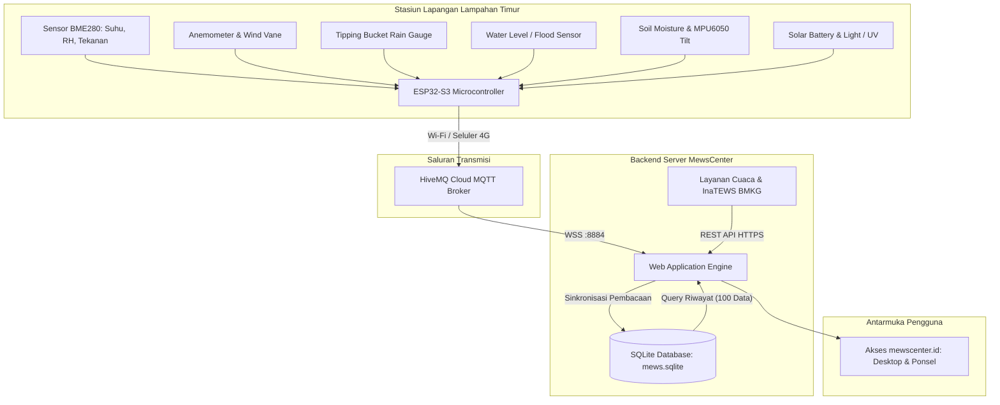

# BUKU PEDOMAN PENGGUNAAN & PANDUAN TEKNIS APLIKASI
## MEWSCENTER (Monitoring Early Warning System)
**Wilayah:** Kampung Lampahan Timur, Kecamatan Timang Gajah, Kabupaten Bener Meriah, Aceh  
**Alamat Akses:** [https://mewscenter.id](https://mewscenter.id)  
**Program:** Program Pengabdian Masyarakat Kolaborasi Indonesia (PMKI) 2026  
**Kerjasama:** Universitas Syiah Kuala (USK) — Universitas Sebelas Maret (UNS) — Institut Teknologi Bandung (ITB) — Pemerintah Kabupaten Bener Meriah  

---

## DAFTAR ISI
1. [Pendahuluan & Gambaran Umum](#1-pendahuluan--gambaran-umum)
2. [Persyaratan Sistem & Akses Aplikasi](#2-persyaratan-sistem--akses-aplikasi)
3. [Panduan Antarmuka Pengguna (User Interface)](#3-panduan-antarmuka-pengguna-user-interface)
   - 3.1. Header & Indikator Status
   - 3.2. Panel Metrik Sensor IoT (13 Parameter)
   - 3.3. Panel Grafik Sensor Real-Time & Riwayat
   - 3.4. Panel Peta Wilayah Interaktif
   - 3.5. Panel Prakiraan Cuaca BMKG
   - 3.6. Panel Informasi Gempa Bumi Terbaru (BMKG TEWS)
   - 3.7. Tampilan Responsif (Mobile View)
4. [Arsitektur Sistem & Aliran Data](#4-arsitektur-sistem--aliran-data)
5. [Source Code Penting](#5-source-code-penting)
   - 5.1. Konfigurasi Client & Endpoint (`app.js`)
   - 5.2. Pipeline Koneksi & Langganan MQTT (`app.js`)
   - 5.3. Pemetaan & Normalisasi Data Sensor (`app.js`)
   - 5.4. Visualisasi Grafik Dinamis Chart.js (`app.js`)
   - 5.5. Integrasi API Cuaca & Gempa BMKG (`app.js`)
   - 5.6. Manajemen Penyimpanan & Sinkronisasi Lokal SQLite (`api/sensor.php`)
6. [Interpretasi Nilai Sensor & Ambang Batas Aman](#6-interpretasi-nilai-sensor--ambang-batas-aman)
7. [Penanganan Gangguan (Troubleshooting)](#7-penanganan-gangguan-troubleshooting)

---

## 1. Pendahuluan & Gambaran Umum

**MewsCenter** (*Monitoring Early Warning System Center*) adalah sistem pemantauan kebencanaan dan cuaca cerdas terpadu berbasis Internet of Things (IoT) dan Web GIS yang dirancang khusus untuk memperkuat mitigasi bencana di wilayah Kampung Lampahan Timur, Kec. Timang Gajah, Kab. Bener Meriah, Aceh.

Wilayah Bener Meriah yang berada pada zona dataran tinggi pegunungan Gayo (±1.200 mdpl) memiliki karakteristik mikroklimat khas serta kerentanan geologis terhadap pergerakan tanah dan aktivitas tektonik. MewsCenter mengintegrasikan stasiun telemetri multi-sensor terpasang di lapangan dengan layanan resmi Badan Meteorologi, Klimatologi, dan Geofisika (BMKG) guna menyediakan data terpercaya kepada masyarakat dan instansi berwenang secara *real-time*.


---

## 2. Persyaratan Sistem & Akses Aplikasi

### Cara Mengakses
Aplikasi dapat diakses langsung tanpa perlu instalasi aplikasi khusus dengan mengunjungi peramban web:
```text
URL Publik: https://mewscenter.id
```

### Kebutuhan Peramban (Browser)
- **Desktop:** Google Chrome (v100+), Mozilla Firefox (v100+), Microsoft Edge (v100+), Apple Safari (v15+).
- **Smartphone/Tablet:** Android Chrome Mobile, iOS Safari.
- **Dukungan Protokol:** Wajib mendukung WebSocket (WSS) dan JavaScript aktif.

---

## 3. Panduan Antarmuka Pengguna (User Interface)

### 3.1. Header & Indikator Status
Header terletak di bagian paling atas layar dan menyajikan identitas aplikasi, status transmisi, dan waktu presisi Indonesia Barat (WIB).


1. **Judul & Lokasi:** Memuat identitas `MewsCenter` dan penanda geografis wilayah pemantauan (`Lampahan Timur, Bener Meriah, Aceh`).
2. **Badge Status Transmisi (`#connectionStatus`):**
   - 🟢 **MQTT Live:** Data streaming langsung diterima dari stasiun pemantau secara real-time.
   - 🟣 **Tersinkronisasi Lokal / Menunggu Data:** Perangkat sedang melakukan pembacaan cadangan dari basis data internal berkeandalan tinggi.
   - 🟡 **Menghubungkan:** Web client sedang melakukan *handshake* protokol WebSocket dengan broker data.
   - 🔴 **Offline / Gagal:** Koneksi internet pengguna terputus atau jaringan broker sedang dalam pemeliharaan.
3. **Jam Digital Real-time:** Menampilkan waktu terkini berformat `HH:MM:SS WIB` yang diperbarui setiap detik.

---

### 3.2. Panel Metrik Sensor IoT (13 Parameter)
Panel ini menampilkan 13 parameter fisis lingkungan mikro dan stabilitas stasiun telemetri dalam bentuk kartu instrumen interaktif. Setiap kartu dilengkapi ikon representatif, pembacaan nilai numerik, persentase progress bar visual, dan indikator tren kenaikan/penurunan (▲/▼).


| No | Parameter | Satuan | Deskripsi & Rentang Normal Operasional |
|:---:|:---|:---:|:---|
| 1 | **Suhu Udara** | °C | Suhu ambien dataran tinggi Bener Meriah (Normal: 16.0 – 27.5 °C). |
| 2 | **Kelembapan Udara** | % | Kelembapan relatif (RH) lingkungan pegunungan (Normal: 65 – 98%). |
| 3 | **Tekanan Udara** | hPa | Tekanan atmosfer aktual stasiun pada elevasi ±1.200 mdpl (Normal: 875 – 885 hPa). |
| 4 | **Kecepatan Angin** | m/s | Laju hembusan angin permukaan (0 – 15 m/s). |
| 5 | **Baterai Sistem** | % | Kapasitas daya akumulator stasiun bertenaga surya (Normal: 70 – 100%). |
| 6 | **Tinggi Genangan Air (Banjir)** | cm | Pemantau tinggi muka air di aliran drainase/sungai (Normal: 0.0 – 1.5 cm). |
| 7 | **Kelembapan Tanah** | % | Kadar air lapisan tanah perakaran untuk deteksi saturasi longsor (Normal: 30 – 75%). |
| 8 | **Kemiringan Pitch** | ° | Inklinasi stasiun arah vertikal/poros X (Normal: -1.0° s/d +1.0°). |
| 9 | **Kemiringan Roll** | ° | Inklinasi stasiun arah lateral/poros Y (Normal: -1.0° s/d +1.0°). |
| 10 | **Arah Angin** | ° | Arah datang angin dalam derajat kompas azimuth (0° – 360°). |
| 11 | **Curah Hujan** | mm | Akumulasi presipitasi harian dari sensor *tipping bucket*. |
| 12 | **Intensitas Cahaya** | lux | Radiasi iluminasi matahari permukaan (0 lux malam hari s/d 100.000 lux terik). |
| 13 | **Indeks UV** | UV | Indeks paparan radiasi ultraviolet sinar matahari (Skala 0 – 12). |

---

### 3.3. Panel Grafik Sensor Real-Time & Riwayat
Panel grafik menyajikan visualisasi runtun waktu (*time series*) untuk 100 data pemantauan terakhir menggunakan library grafis Chart.js. Pengguna dapat berganti instrumen pemantauan secara cepat menggunakan tombol filter di sudut kanan atas panel.

#### A. Grafik Suhu Udara (°C)
Menampilkan dinamika temperatur harian dengan kurva transisi halus:


#### B. Grafik Kelembapan Udara (%)
Menampilkan fluktuasi saturasi uap air di udara:


#### C. Grafik Tekanan Udara (hPa)
Menampilkan osilasi tekanan stasiun (termasuk fenomena pasang surut atmosfer barometrik):


#### D. Fitur Interaktif Tooltip
Arahkan kursor (*hover*) pada sembarang titik kurva untuk melihat pembacaan terperinci beserta stempel waktu presisi tanggal dan jam:


---

### 3.4. Panel Peta Wilayah Interaktif
Peta berbasis Leaflet.js yang menunjukkan lokasi titik stasiun telemetri MewsCenter di Kampung Lampahan Timur, lengkap dengan koordinat geospasial presisi (`4.759653°N, 96.775189°E`) serta radius pantauan proteksi 1 km.


- **Navigasi:** Pengguna dapat melakukan perbesaran (*zoom in/out*) menggunakan kontrol `+` / `-` atau cubitan layar pada ponsel.
- **Marker Utama:** Mengeluarkan pop-up informasi wilayah administratif saat diklik.

---

### 3.5. Panel Prakiraan Cuaca BMKG
Mengambil data resmi prakiraan cuaca dari server Pusat Data BMKG per 3 jam untuk wilayah administratif Lampahan Timur / Timang Gajah.


- Menampilkan ikon kondisi langit resmi BMKG (Cerah, Berawan, Hujan Ringan, dll).
- Informasi estimasi temperatur (°C), kelembapan (%), dan arah serta laju angin (km/jam).
- Dikelompokkan otomatis berdasarkan hari untuk memudahkan perencanaan mitigasi lapangan.

---

### 3.6. Panel Informasi Gempa Bumi Terbaru (BMKG TEWS)
Terhubung dengan jaringan *Indonesia Tsunami Early Warning System* (InaTEWS) BMKG untuk menyajikan informasi guncangan gempa bumi termutakhir yang dirasakan atau berpotensi di wilayah Indonesia.


- **Parameter:** Menampilkan magnitudo gempa, episentrum wilayah, waktu kejadian (WIB), koordinat lintang/bujur, kedalaman hiposentrum, dan status potensi tsunami.
- **Peta Shakemap:** Menampilkan peta distribusi guncangan intensitas MMI jika dirilis oleh BMKG.
- **Marker Peta Otomatis:** Sistem secara otomatis menambahkan titik koordinat gempa ke dalam peta utama untuk melihat jarak relatif terhadap Bener Meriah.

---

### 3.7. Footer Kemitraan PMKI 2026
Bagian penutup menampilkan logo resmi kolaborator institusi pelaksana Program Pengabdian Masyarakat Kolaborasi Indonesia (PMKI) 2026:
- Universitas Syiah Kuala (USK)
- Universitas Sebelas Maret (UNS)
- Institut Teknologi Bandung (ITB)
- Pemerintah Daerah Kabupaten Bener Meriah


---

### 3.8. Tampilan Responsif (Mobile View)
Aplikasi didesain mengadopsi standar *responsive web design* terkini. Antarmuka otomatis beradaptasi saat dibuka melalui perangkat telepon pintar (smartphone) tanpa mengurangi fungsionalitas.

| Tampilan Header & Sensor Mobile | Tampilan Metrik Lanjutan Mobile |
|:---:|:---:|
|  |  |

---

## 4. Arsitektur Sistem & Aliran Data

Sistem MewsCenter menerapkan arsitektur berdaya tahan tinggi (*resilient IoT data pipeline*). Aliran data didesain dengan prinsip redundansi ganda:



---

## 5. Source Code Penting

Berikut adalah dokumentasi komponen kode inti yang membangun platform MewsCenter:

### 5.1. Konfigurasi Client & Endpoint (`app.js`)
Konfigurasi terpusat mencakup jalur broker MQTT WebSocket, API lokal penyimpanan SQLite, layanan BMKG, dan koordinat peta.

```javascript
// ===== CONFIG =====
const CONFIG = {
    mqtt: {
        brokerUrl: 'wss://broker.hivemq.com:8884/mqtt',
        topic: 'weather_station/esp32s3/data',
        clientId: `mewscenter-${Math.random().toString(16).slice(2)}`,
    },
    api: {
        url: 'api/sensor.php',
        pollInterval: 15000,   // Pembaruan data berkala 15 detik
        mqttTimeout: 10000,    // Waktu tunggu deteksi sinyal stasiun sebelum sinkronisasi lokal
    },
    bmkg: {
        weatherUrl: 'https://api.bmkg.go.id/publik/prakiraan-cuaca?adm4=11.17.07.2028',
        earthquakeUrl: 'https://data.bmkg.go.id/DataMKG/TEWS/autogempa.json',
        shakemapBase: 'https://data.bmkg.go.id/DataMKG/TEWS/',
        weatherRefresh: 600000,    // Refresh prakiraan cuaca tiap 10 menit
        earthquakeRefresh: 60000,  // Refresh deteksi gempa tiap 1 menit
    },
    map: {
        lat: 4.7596528158,
        lon: 96.7751885943,
        zoom: 14,
    }
};
```

---

### 5.2. Pipeline Koneksi & Langganan MQTT (`app.js`)
Mengelola siklus koneksi WebSocket ke broker MQTT dengan sistem *auto-reconnect* dan penanganan status jaringan:

```javascript
function connectMqtt() {
    if (mqttClient) return;
    setConnectionStatus('connecting', 'Menghubungkan...');
    mqttClient = mqtt.connect(CONFIG.mqtt.brokerUrl, { 
        clientId: CONFIG.mqtt.clientId, 
        clean: true, 
        reconnectPeriod: 5000 
    });

    const client = mqttClient;
    client.on('connect', () => client.subscribe(CONFIG.mqtt.topic, err => {
        if (err) { 
            console.error('MQTT subscribe error:', err); 
            setConnectionStatus('error', 'Gagal subscribe'); 
            return; 
        }
        if (dataMode === 'waiting') {
            setConnectionStatus('online', 'MQTT Online · Menunggu data');
            document.getElementById('sensorLastUpdate').textContent = 'Menunggu payload sensor...';
        }
    }));

    client.on('message', (topic, message) => {
        if (topic !== CONFIG.mqtt.topic) return;
        try {
            const data = JSON.parse(message.toString());
            switchToMqttMode();
            const vals = updateSensorCards(data);
            storeMqttReading(vals); // Sinkronisasi otomatis ke basis data internal
        } catch (err) { 
            console.error('Payload MQTT tidak valid:', err); 
        }
    });
}
```

---

### 5.3. Pemetaan & Normalisasi Data Sensor (`app.js`)
Fungsi `readNumber` menjamin kompatibilitas fleksibel terhadap berbagai struktur payload JSON dari firmware mikrokontroler:

```javascript
function updateSensorCards(data, dt = new Date()) {
    const readNumber = (paths) => {
        for (const path of paths) {
            const value = path.split('.').reduce((current, key) => current?.[key], data);
            const number = Number(value);
            if (value !== undefined && value !== null && Number.isFinite(number)) return number;
        }
        return NaN;
    };

    const vals = {
        temp: readNumber(['temp', 'temperature', 'bme280.temperature', 'bme280.temp']),
        humidity: readNumber(['rh', 'humidity', 'bme280.humidity']),
        pressure: readNumber(['pres', 'pressure', 'bme280.pressure']),
        windSpeed: readNumber(['ws', 'wind.speed', 'wind.speed_ms', 'wind_speed']),
        windDirection: readNumber(['wd', 'wind.direction', 'wind.degrees']),
        rain: readNumber(['rain.mm', 'rain.amount', 'rain_mm', 'rain']),
        flood: readNumber(['flood']),
        soilMoisture: readNumber(['soil.percent', 'soil.moisture', 'soil_moisture']),
        pitch: readNumber(['pitch', 'mpu.pitch']),
        roll: readNumber(['roll', 'mpu.roll']),
        lux: readNumber(['lux']),
        uv: readNumber(['uv']),
        battery: readNumber(['batt', 'battery']),
    };

    // Render angka ke elemen UI
    setVal('sensorTemp', vals.temp, 2);
    setVal('sensorHumidity', vals.humidity, 1);
    setVal('sensorPressure', vals.pressure, 1);
    // ... pembaruan elemen dan progress bar lainnya ...
    
    updateSensorChart(vals, dt);
    return vals;
}
```

---

### 5.4. Visualisasi Grafik Dinamis Chart.js (`app.js`)
Konfigurasi grafik adaptif dengan sumbu waktu riil, palet warna elegan, dan kontrol pertukaran metrik:

```javascript
function initChart() {
    const ctx = document.getElementById('sensorChart').getContext('2d');
    sensorChart = new Chart(ctx, {
        type: 'line',
        data: {
            labels: [],
            datasets: [{
                label: 'Suhu (°C)',
                data: [],
                borderColor: '#f59e0b',
                backgroundColor: 'rgba(245, 158, 11, 0.1)',
                borderWidth: 2, tension: 0.4, fill: true,
                pointRadius: 0, pointHitRadius: 10,
            }]
        },
        options: {
            responsive: true, maintainAspectRatio: false,
            scales: {
                x: {
                    type: 'time',
                    time: { displayFormats: { minute: 'HH:mm', hour: 'HH:mm' } },
                    grid: { color: 'rgba(255,255,255,0.04)' }
                },
                y: { grid: { color: 'rgba(255,255,255,0.04)' } }
            }
        }
    });
}
```

---

### 5.5. Integrasi API Cuaca & Gempa BMKG (`app.js`)
Mengambil data resmi BMKG secara asinkron tanpa membebani browser pengguna:

```javascript
async function fetchWeather() {
    try {
        const res = await fetch(CONFIG.bmkg.weatherUrl);
        if (!res.ok) throw new Error('Weather fetch failed');
        const data = await res.json();
        renderWeather(data);
    } catch (err) {
        console.error('BMKG Weather error:', err);
    }
}

async function fetchEarthquake() {
    try {
        const res = await fetch(CONFIG.bmkg.earthquakeUrl);
        if (!res.ok) throw new Error('Earthquake fetch failed');
        const data = await res.json();
        renderEarthquake(data);
    } catch (err) {
        console.error('BMKG Earthquake error:', err);
    }
}
```

---

### 5.6. Manajemen Penyimpanan & Sinkronisasi Lokal SQLite (`api/sensor.php`)
Backend PHP ringan berbasis SQLite (WAL mode) untuk memastikan ketersediaan data pemantauan dan riwayat 100 titik terakhir:

```php
<?php
declare(strict_types=1);

header('Content-Type: application/json; charset=utf-8');
header('Cache-Control: no-store');
date_default_timezone_set('Asia/Jakarta');

const DB_FILE = __DIR__ . '/../data/mews.sqlite';
const FIELDS = [
    'temp', 'humidity', 'pressure', 'wind_speed', 'wind_direction', 
    'rain', 'rain_rate', 'flood', 'soil_moisture', 'pitch', 'roll', 
    'lux', 'uv', 'battery'
];

function db(): PDO {
    $dir = dirname(DB_FILE);
    if (!is_dir($dir)) {
        mkdir($dir, 0775, true);
        file_put_contents($dir . '/.htaccess', "Require all denied\n");
    }
    $pdo = new PDO('sqlite:' . DB_FILE);
    $pdo->setAttribute(PDO::ATTR_ERRMODE, PDO::ERRMODE_EXCEPTION);
    $pdo->setAttribute(PDO::ATTR_DEFAULT_FETCH_MODE, PDO::FETCH_ASSOC);
    $pdo->exec('PRAGMA journal_mode = WAL');
    
    // Inisialisasi tabel telemetri jika belum ada
    $cols = implode(', ', array_map(fn($f) => "$f REAL", FIELDS));
    $pdo->exec("CREATE TABLE IF NOT EXISTS readings (
        id INTEGER PRIMARY KEY AUTOINCREMENT,
        ts INTEGER NOT NULL,
        source TEXT NOT NULL,
        $cols
    )");
    return $pdo;
}
```

---

## 6. Interpretasi Nilai Sensor & Ambang Batas Aman

Untuk mendukung fungsi sebagai sistem peringatan dini (Early Warning System), berikut adalah tabel panduan status dan tindakan yang direkomendasikan bagi pengelola/warga:

| Parameter | Kondisi Normal (Hijau) | Waspada (Kuning) | Bahaya (Merah) | Rekomendasi Mitigasi |
|---|:---:|:---:|:---:|---|
| **Curah Hujan (1 Jam)** | < 5 mm | 5 – 20 mm | > 20 mm / jam | Siagakan tim drainase; pantau potensi limpasan air lereng. |
| **Tinggi Air Banjir** | < 1.0 cm | 1.0 – 3.0 cm | > 3.0 cm | Evakuasi barang berharga di dekat bantaran parit/sungai. |
| **Kelembapan Tanah** | 30 – 60% | 60 – 75% | > 80% (Jenuh) | Waspada longsor pada tebing curam di sekitar permukiman. |
| **Kemiringan Pitch/Roll** | deviasi < 0.5° | deviasi 0.5° – 1.5° | deviasi > 2.0° | Indikasi pergeseran tiang/pondasi stasiun pemantau akibat erosi. |
| **Kecepatan Angin** | < 10 m/s | 10 – 17 m/s | > 17 m/s (Badai) | Waspada pohon tumbang dan atap seng beterbangan. |
| **Tegangan Baterai** | > 70% | 30 – 70% | < 25% | Bersihkan debu/kotoran pada permukaan panel surya stasiun. |

---

## 7. Penanganan Gangguan (Troubleshooting)

### Q1: Halaman web tidak memperbarui data secara otomatis
- **Solusi:** Periksa koneksi internet Anda. Pastikan jaringan internet Anda tidak memblokir port WebSocket SSL (Port 8884). Tekan `Ctrl + F5` untuk membersihkan cache peramban.

### Q2: Status menunjukkan "Menghubungkan..." dalam waktu lama
- **Solusi:** Sistem akan secara otomatis mengaktifkan mode redundansi lokal dalam 10 detik agar data pemantauan lingkungan tetap dapat dibaca oleh pengguna.

### Q3: Tampilan peta tidak memuat citra jalan/wilayah
- **Solusi:** Leaflet bergantung pada koneksi ke server OpenStreetMap. Pastikan kuota internet aktif dan akses ke domain `tile.openstreetmap.org` tidak dibatasi oleh firewall lokal.

---

*MewsCenter — Program Pengabdian Masyarakat Kolaborasi Indonesia (PMKI) 2026*  
*Universitas Syiah Kuala — Universitas Sebelas Maret — Institut Teknologi Bandung — Pemkab Bener Meriah*
